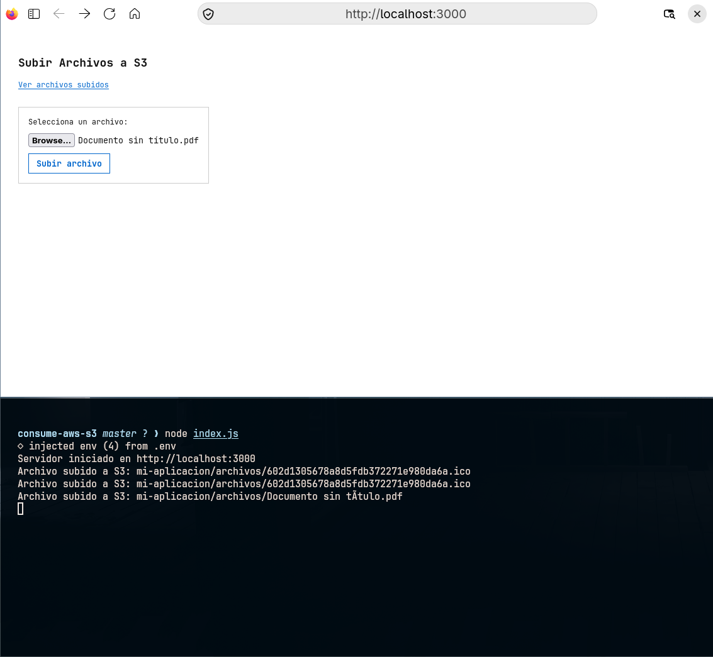
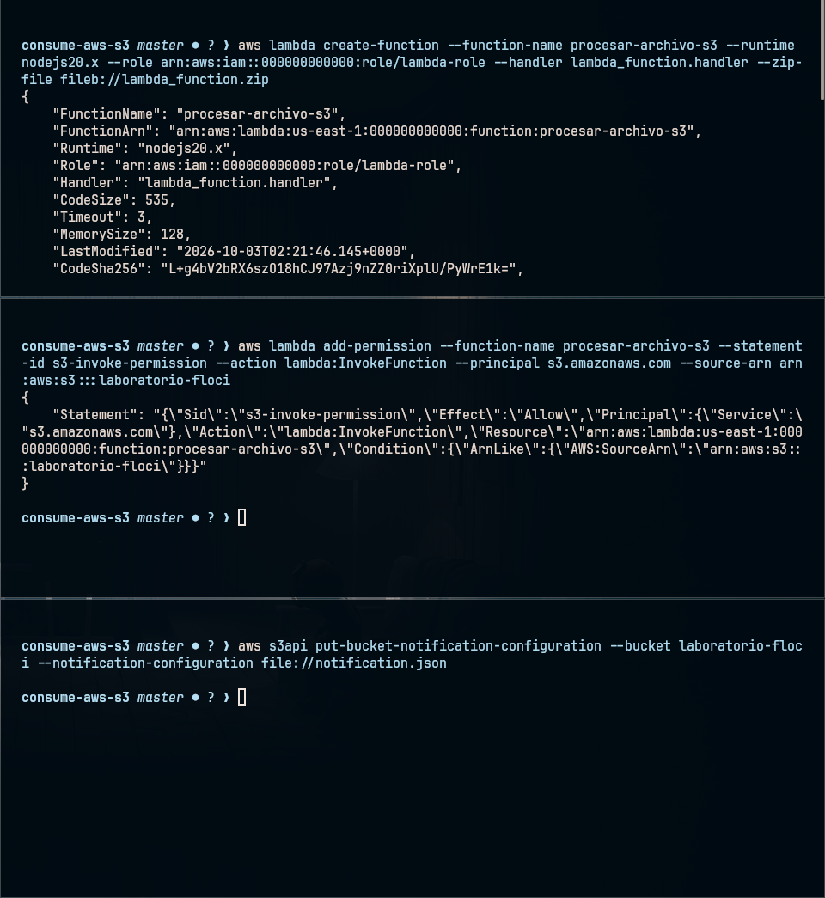
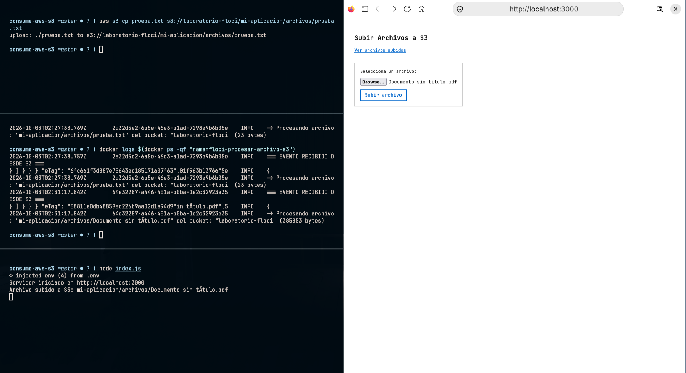
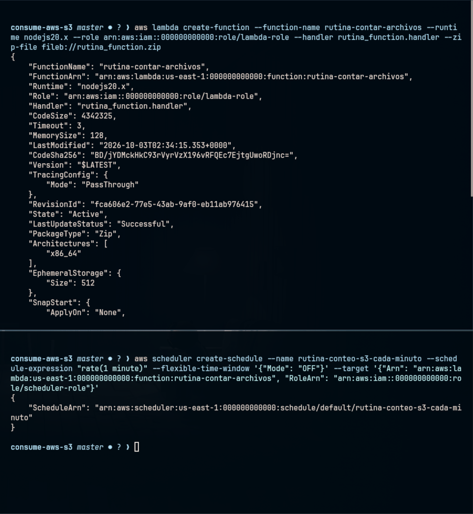
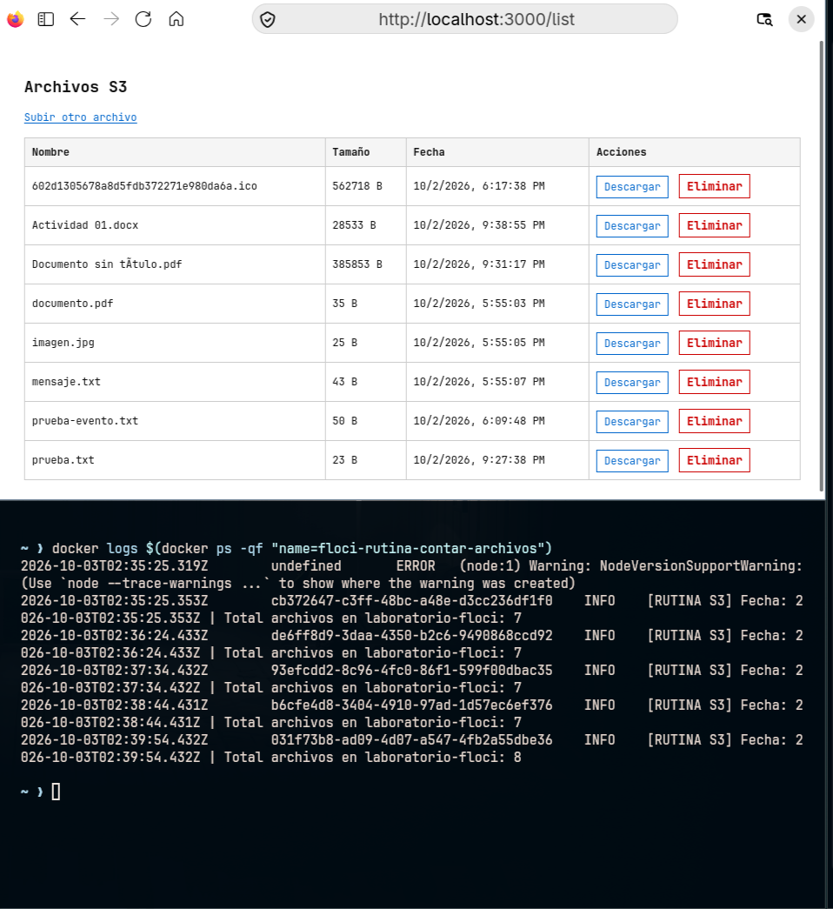

# Consumo de AWS S3 y Arquitecturas Serverless

Proyecto de integración con AWS S3 y funciones serverless (AWS Lambda y EventBridge Scheduler) ejecutadas localmente con Floci en Linux.

---

## 1. Descripcion General

Aplicación web en Node.js (Express) para gestionar archivos en el bucket S3 `laboratorio-floci`:

- **Gestión de archivos:** Subida y listado directo bajo la ruta `mi-aplicacion/archivos/` usando `@aws-sdk/client-s3`.
- **Automatizaciones serverless:**
  1. **Disparo automático:** S3 avisa a una Lambda cada vez que se sube un archivo.
  2. **Rutina programada:** EventBridge ejecuta una Lambda cada minuto para contar los archivos en el bucket.



---

## 2. Tarea 1: Procesamiento Automatico por Eventos (S3 -> Lambda)

### Objetivo
Procesar automáticamente los datos de cada archivo nuevo que se suba al bucket S3 usando notificaciones (`s3:ObjectCreated:*`).

### Diagrama de Flujo
```
[ Cliente Web ] --> [ Express: Subir archivo ] --> [ S3: laboratorio-floci ]
                                                          |
                                                          | Notificacion automatica
                                                          v
                                                [ Lambda: procesar-archivo-s3 ]
```

### Codigo de la Funcion (`lambda_function.js`)
```javascript
exports.handler = async (event) => {
    console.log("=== EVENTO RECIBIDO DESDE S3 ===");
    console.log(JSON.stringify(event, null, 2));

    if (event.Records) {
        for (const record of event.Records) {
            const bucket = record.s3.bucket.name;
            const key = decodeURIComponent(record.s3.object.key.replace(/\+/g, ' '));
            const size = record.s3.object.size;

            console.log(`-> Procesando archivo: "${key}" del bucket: "${bucket}" (${size} bytes)`);
        }
    }

    return {
        statusCode: 200,
        body: JSON.stringify({ message: "Archivo procesado exitosamente" })
    };
};
```

### Pasos de Despliegue

1. **Comprimir el codigo:**
   ```bash
   zip lambda_function.zip lambda_function.js
   ```

2. **Crear la funcion Lambda:**
   ```bash
   aws lambda create-function \
     --function-name procesar-archivo-s3 \
     --runtime nodejs20.x \
     --role arn:aws:iam::000000000000:role/lambda-role \
     --handler lambda_function.handler \
     --zip-file fileb://lambda_function.zip
   ```

3. **Dar permisos a S3 para ejecutar la funcion:**
   ```bash
   aws lambda add-permission \
     --function-name procesar-archivo-s3 \
     --statement-id s3-invoke-permission \
     --action lambda:InvokeFunction \
     --principal s3.amazonaws.com \
     --source-arn arn:aws:s3:::laboratorio-floci
   ```

4. **Configurar el disparador en el Bucket S3 (`notification.json`):**
   ```json
   {
     "LambdaFunctionConfigurations": [
       {
         "LambdaFunctionArn": "arn:aws:lambda:us-east-1:000000000000:function:procesar-archivo-s3",
         "Events": ["s3:ObjectCreated:*"],
         "Filter": {
           "Key": {
             "FilterRules": [
               {
                 "Name": "prefix",
                 "Value": "mi-aplicacion/archivos/"
               }
             ]
           }
         }
       }
     ]
   }
   ```

   ```bash
   aws s3api put-bucket-notification-configuration \
     --bucket laboratorio-floci \
     --notification-configuration file://notification.json
   ```



### Verificacion y Logs

Al subir un archivo al bucket S3 (`prueba.txt`), la funcion se ejecuta inmediatamente:

```bash
docker logs $(docker ps -qf "name=floci-procesar-archivo-s3")
```



---

## 3. Tarea 2: Rutina Programada por Tiempo (EventBridge Scheduler -> Lambda)

### Objetivo
Ejecutar una tarea automática cada minuto (`rate(1 minute)`) que consulte el bucket S3, cuente los archivos almacenados y muestre el total en los registros.

### Diagrama de Flujo
```
[ EventBridge Scheduler ] --> (Cada 1 minuto) --> [ Lambda: rutina-contar-archivos ]
                                                           |
                                                           | Consulta archivos en S3
                                                           v
                                                  [ S3: laboratorio-floci ]
```

### Codigo de la Funcion (`rutina_function.js`)
```javascript
const { S3Client, ListObjectsV2Command } = require('@aws-sdk/client-s3');

const s3Client = new S3Client({
    region: process.env.AWS_REGION || 'us-east-1',
    endpoint: process.env.AWS_ENDPOINT_URL || 'http://localhost.floci.io:4566',
    credentials: {
        accessKeyId: process.env.AWS_ACCESS_KEY_ID || 'test',
        secretAccessKey: process.env.AWS_SECRET_ACCESS_KEY || 'test'
    },
    forcePathStyle: true
});

const BUCKET = process.env.AWS_S3_BUCKET || 'laboratorio-floci';

exports.handler = async () => {
    const data = await s3Client.send(new ListObjectsV2Command({ Bucket: BUCKET }));
    const total = (data.Contents || []).length;

    console.log(`[RUTINA S3] Fecha: ${new Date().toISOString()} | Total archivos en ${BUCKET}: ${total}`);

    return { total };
};
```

### Pasos de Despliegue

1. **Comprimir la funcion junto a sus dependencias:**
   ```bash
   zip -r rutina_function.zip rutina_function.js node_modules package.json
   ```

2. **Crear la funcion Lambda:**
   ```bash
   aws lambda create-function \
     --function-name rutina-contar-archivos \
     --runtime nodejs20.x \
     --role arn:aws:iam::000000000000:role/lambda-role \
     --handler rutina_function.handler \
     --zip-file fileb://rutina_function.zip
   ```

3. **Crear la programacion en EventBridge Scheduler:**
   ```bash
   aws scheduler create-schedule \
     --name rutina-conteo-s3-cada-minuto \
     --schedule-expression "rate(1 minute)" \
     --flexible-time-window '{"Mode": "OFF"}' \
     --target '{"Arn": "arn:aws:lambda:us-east-1:000000000000:function:rutina-contar-archivos", "RoleArn": "arn:aws:iam::000000000000:role/scheduler-role"}'
   ```



### Verificacion y Logs

El programador activa la funcion cada 60 segundos automáticamente:

```bash
docker logs $(docker ps -qf "name=floci-rutina-contar-archivos")
```



---

## 4. Comparativa entre Ambas Soluciones

| Caracteristica | Tarea 1: Disparo por S3 | Tarea 2: Programada por Tiempo |
| :--- | :--- | :--- |
| **Origen del disparo** | Subida de un archivo (`s3:ObjectCreated:*`). | Reloj / Temporizador (`rate(1 minute)`). |
| **Funcionamiento** | **Automático:** S3 envía los datos a la función al subir el archivo. | **Periódico:** La función consulta a S3 cada minuto para contar archivos. |
| **Dependencias** | Módulos estándar de Node.js. | Paquete `@aws-sdk/client-s3` incluido en el ZIP. |
| **Configuración** | Permiso en Lambda (`add-permission`) + Notificación en S3. | Horario en EventBridge Scheduler apuntando a la Lambda. |
| **Uso principal** | Procesar archivos al instante cuando llegan. | Auditorías, reportes y conteos periódicos. |

---

## 5. Comandos Utiles

Comandos de consulta y monitoreo en tiempo real:

```bash
# Listar funciones Lambda
aws lambda list-functions

# Listar tareas programadas en Scheduler
aws scheduler list-schedules

# Ver logs en vivo de cada contenedor
docker logs -f $(docker ps -qf "name=floci-procesar-archivo-s3")
docker logs -f $(docker ps -qf "name=floci-rutina-contar-archivos")
docker logs -f floci
```
